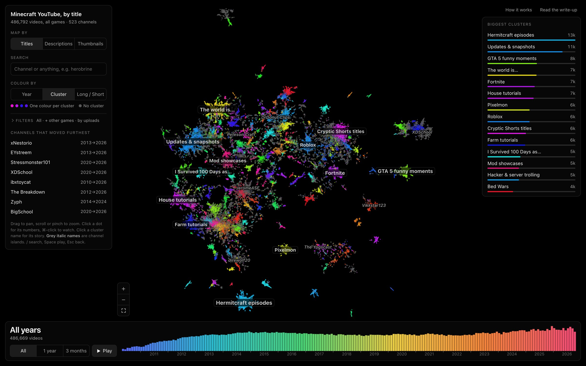
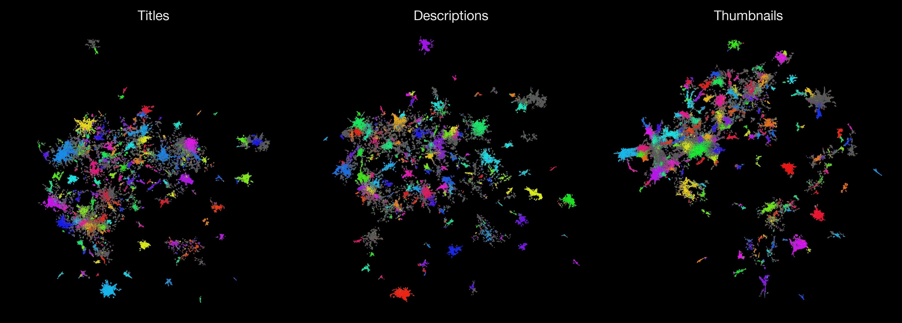
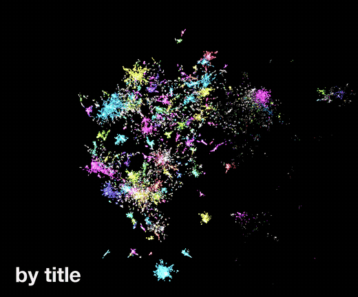
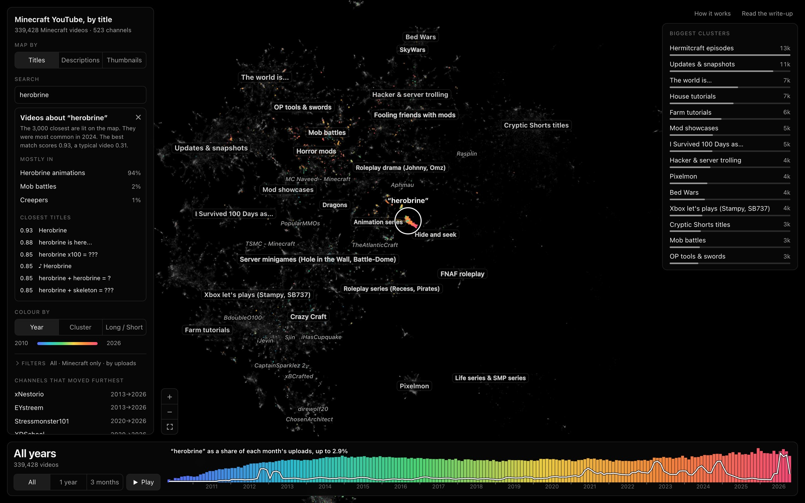
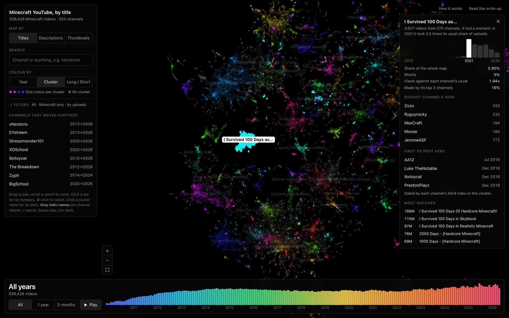

# Minecraft YouTube, mapped

Every upload from the 523 biggest Minecraft YouTube channels, about 487,000 videos from 2009 to 2026, embedded and laid out as one zoomable map. Similar videos sit together, so the clusters are the topics: Hermitcraft, 100 Days, Bed Wars, redstone tutorials, cryptic Shorts titles, and about 200 more, all named by hand.



There are three maps of the same videos, each built from a different embedding:

| Map | What gets embedded | Model |
|---|---|---|
| Titles | the title | OpenAI `text-embedding-3-small`, 512 dims |
| Descriptions | title + description, with the channel's repeated boilerplate stripped | OpenAI `text-embedding-3-small`, 512 dims |
| Thumbnails | the thumbnail image only | Gemini Embedding 2, 768 dims |



The same videos flying between the three maps, coloured by their title topic. Clusters that hold together are topics all three embeddings agree on; the thumbnail map mixes title topics much more.



## What you can do with it

- **Search an idea.** Type "herobrine" and the 3,000 closest videos light up, with the clusters they fall in, the closest titles and how common the idea was each month. On the thumbnail map you can search a picture in words ("red arrow and shocked face"), because Gemini puts text and images in one space.
- **Open a cluster.** It shows its size, which year it peaked, its biggest channels, who posted there first and its most watched videos.
- **Scrub through time.** The timeline at the bottom filters the map to a year or a 3-month window, and Play animates it from 2010 to 2026.
- **Follow a channel.** Search a channel to see its path across the map year by year.





There is also a write-up, `web/blog.html`, covering what changed over 17 years: the eras, title shapes, the 10-minute ad line, average thumbnails per year and new mobs.

## How it's built

Every script named here is in `pipeline/`.

1. **Channels.** Candidates come from a hand-picked MCYT list plus scrapes of Minecraft hashtag and search pages. An OpenAI model reads each channel's 25 newest titles, and channels that are at least 50% Minecraft are kept (`build_list.py`, `classify.py`).
2. **Videos.** Every long video and Short comes from the YouTube Data API upload playlists, plus views and duration (`fetch_videos.py`, `fetch_details.py`). Each title is tagged "is this Minecraft?" so other games can be hidden (`tag_mc.py`).
3. **Embeddings.** Titles, cleaned descriptions and thumbnails are embedded (`embed.py`, `embed_rich.py`, `thumbs.py`, `embed_thumbs.py`).
4. **Layout** (`map.py`, `knn.py`):
   - **Neighbours from other channels.** Plain nearest neighbours of a title are mostly the same channel's other episodes, so UMAP drew a thousand one-channel islands. Instead, each video's neighbour list is built mostly from *other* channels' similar videos (12 of 15), which lays the map out by topic rather than by each channel's title template.
   - **Clusters.** UMAP gives a 2-d picture, and a separate 8-d UMAP feeds HDBSCAN. Unclustered videos join a cluster when their neighbours agree. A cluster that is more than 60% one channel is that channel's series, not a topic, so it gets folded out.
   - **Tidy.** Any piece of the map you could see floating on its own at full zoom-out (under 1,000 videos, or under 5,000 and mostly one channel) moves as one unit next to its true nearest neighbours.
   - **Result.** On the title map this took 1,092 visible pieces down to 43, and 82% of each video's 12 nearest neighbours in embedding space still land in its closest 1% of the map.
5. **Names.** Every cluster has a hand-written name. Names carry over between rebuilds by matching cluster centres. Off-topic clusters (vlogs, music, IRL) are dropped, and other-game clusters (Roblox, Fortnite, GTA) are hidden by default.
6. **Numbers.** `islands.py`, `insights.py`, `analyze.py`, `stats.py`, `finds.py` and `viz.py` compute the UI's panels and the blog's charts.

The front end is one HTML file, `web/index.html`, drawing all the dots with WebGL. There is no framework and no build step.

## What's where

```
serve.py       the local server: web/ plus the search and neighbour endpoints
web/           the map (index.html), the write-up (blog.html) and the data they load
pipeline/      every step from channel list to finished map, in the order above
scripts/       shell runners that chained the steps overnight, and shot.py for screenshots
experiments/   the layout, tidy and vote tests behind the choices in knn.py
docs/          README images and GIFs (shots.py, compose.py, morph.py, sections.py, tour.py)
```

## Run it

```sh
uv sync
uv run python serve.py   # http://localhost:8395  (?map=rich, ?map=thumb)
```

`web/` has everything the map needs: points, titles, clusters and the blog. Search and nearest-neighbour lookups also need the raw vectors in `data/`, which are not in the repo (about 1.7 GB). To rebuild them, put `YOUTUBE_API_KEY`, `OPENAI_API_KEY` and `GEMINI_API_KEY` in `.env` and run the pipeline above.
